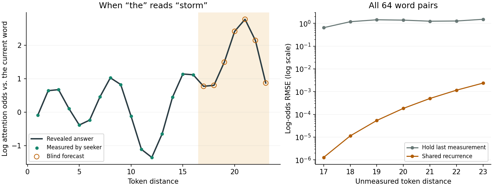

# BlackBox Spotlight

**Can you hear a transformer's positional clock through the output of one attention head?**

We gave a seeker access to one measurement. Send a sequence of words to a frozen head and receive the final position's 12-number output. The seeker chooses probe words, infers a routing rule, and predicts where the head will look on a fresh sequence. The actual attention weights stay behind an answer-key interface until scoring.

On both first-layer heads of **OneTinyTransformer**, the inferred rule reconstructed routing on unseen combinations of eight words. The stronger test was distance. We stopped measuring at 16 tokens back. The inferred rhythm predicted a peak at distance 21 in the example below. Both second-layer heads broke the measurement model on the ninth probe.



**Try it.** Download [index.html](index.html) and open it in a browser. It is a single offline file. Click **Reveal actual routing**, then switch **Prediction rule** to **Distance only**. The current row shows how much attention moves to the wrong words. **Change word 2** lets you test an edit. Use the slider to inspect a different query position. The page uses the fitted rule and recomputes the original first-layer answer live. Python runs the actual inverse experiment.

## What transferred

Each row averages the final query's total variation distance across 384 new 24-token prompts (three seeds, 128 prompts each). It measures how much attention probability would have to move to make the prediction agree with the head. Smaller is better. The first 16 lags were measured for the corresponding target words in every condition.

| Forecast for distances 17–23 | Hold distance 16 flat | Learned recurrence |
|---|---:|---:|
| Head 1, original eight words | 17.785% | **0.0138%** |
| Head 2, original eight words | 6.962% | **0.0051%** |
| Head 2, eight different words, recurrence borrowed from head 1 | 7.093% | **0.0060%** |

In the transfer row, head 2 contributed short-distance measurements for *train, river, night, wind, rain, light, sky, shore*. The recurrence coefficients came entirely from head 1 on *the, storm, moves, across, dark, sea, moon, period*. This separates the timing rule that transfers from the token-pair measurements that each head still needs.

The scoring also examines faraway links on their own. For head 1, the root-mean-square error of distant **log odds** fell from 1.311 to 0.00105. For head 2 it fell from 0.843 to 0.000666. Editing word 3 while preserving the final query gave relative RMS errors of 0.047% and 0.036% in the **change in head output**, respectively. These are effects at the measured head. The experiment does not measure the resulting next-word probability.

## How a probe works

1. **Ask for one word.** A singleton can attend only to itself. Its output measures the value vector that the first-layer head associates with that word.
2. **Build a triangle.** To measure how “the” reads “storm” at distance 5, place a third word in all four intervening positions. The seeker picks a filler whose measured value lies far from the line joining the other two. The output's position inside this triangle gives the three mixture masses. Dividing the source mass by the final word's mass cancels the common attention denominator.
3. **Resolve repeats.** Two copies of “the” share a value vector. Moving mass between them is invisible in a single reading. A calibrated third word supplies a reference. Its mass in a second probe lets the seeker solve for the missing repeat weight. A collapsed value space or an output outside the expected span produces an explicit unresolved result.
4. **Predict a new sequence.** Store the log odds for each query word, source word and distance. Assemble the odds appropriate to a new sequence and normalize to get a routing distribution. The candidates range from uniform attention through distance-only, pair-only, pair plus a query-specific distance effect, and the full pair-by-distance table. These simpler summaries are averages in log-odds space. They are baselines, with no claim of global optimality for vector prediction.
5. **Predict an unmeasured distance.** Fit a single linear recurrence jointly to the 64 log-odds traces, with no position frequencies supplied. Select the order using lags 13–16 after fitting on 1–12, then refit at that order on 1–16. Only then forecast lags 17–23. Both heads selected order 9.

The full measurement requires **1,032 distinct output queries per head**. Every calibration prompt uses at most three distinct words. Each held-out prompt has at least four. On 128 validation sequences, the selector accepts the first listed family with normalized output RMSE ≤ 0.01. It uses only the vector outputs. The attention audit then checks mean routing TV ≤ 0.01 on each test seed. All tests use the same frozen model, and sequences are uniform random recombinations within a controlled vocabulary. The seeds sample prompts, not separately trained models. This is an exploratory benchmark.

## Which frequencies were visible?

The roots of the fitted recurrence expose oscillation rates. Comparing the three fastest with the known rotary position encoding (RoPE) gives the following values in radians per token.

| Mode | Head 1 estimate | Head 2 estimate | Model |
|---|---:|---:|---:|
| Fastest | 1.00000 | 1.00000 | 1.00000 |
| Second | 0.46417 | 0.46416 | 0.46416 |
| Third | 0.21580 | 0.21520 | 0.21544 |

The slower estimated mode differs between heads. The short window leaves the three slowest model frequencies unresolved individually. A forecast can be accurate while the underlying frequency list remains ambiguous. Switching off the rotary transformation in the frozen model gives a causal control. Both heads then pass with a token-pair-only rule, with output error below 3 × 10⁻¹³ on validation.

## Where the instrument fails

- **Layer 2.** On both heads the very first two-word output fell outside the line between the singleton values. The relative span residuals were 0.0192 and 0.128. Context already changes the vectors entering this layer. That observation rules out this fixed-singleton-value model. It does not determine the routing law for layer 2.
- **Precision.** Rounding only the observed vectors to float32 kept the long-prompt forecast usable (0.130% and 0.077% mean TV on the precision-control batch). Rounding observations to float16 tripped the geometric tolerance on probe nine for both heads. These are emulated measurement precisions on the same float64 forward computation. The tolerance was set for clean digital outputs.
- **Access and prior knowledge.** The measurement is one isolated head's weighted value vector before concatenation and output projection. This is a stronger access assumption than observing a chatbot's generated text. The experiment supplies a family of possible mixture laws and recurrence orders. Its answer identifies relative routing behavior within that family. Absolute logits, unique Q/K matrices, general language ability and end-to-end causal importance are outside what these measurements determine.
- **Scope.** The result covers one trained model, two recovered heads, short contexts and two small vocabularies. The probe schedule exhausts word pairs and lags, while adaptively choosing its filler and reference words from measured geometry. No sample-efficiency advantage over random probing was tested.

## Reproduce

Python with NumPy is sufficient for the experiment. The original trained weights are included. A CPU is enough.

```sh
python -m pip install numpy
python experiment.py
python -m unittest discover -s tests -v
python build_demo.py
node tests/bench.test.cjs
```

The optional figure can be rebuilt with `python -m pip install matplotlib` followed by `python plot_result.py`. The Node test exercises the bundled JavaScript and its controls in a DOM stub. Four reference cases also check the Python forward calculation against measured outputs from the original OneTinyTransformer JavaScript.

- [Raw receipt, controls and seeds](results/receipt.json)
- [Recovered values and log-odds tables, including extrapolated lags](results/recovered.json)
- [Inverse algorithm](spotlight/inverse.py) · [frozen model and answer key](spotlight/oracle.py) · [experiment protocol](experiment.py)

## Lineage

[SighImageInverse](https://github.com/anttiluode/SighImageInverse) showed what happens when an input leaves a frequency band dark. Here, repeated source values can leave an attention split invisible. A deliberately chosen third word illuminates it. [Luotain2](https://github.com/anttiluode/luotain2) supplied the test discipline. Let simpler explanations compete, predict held-out observations, and keep the failed cases in the receipt.

The frozen MIT-licensed model comes from [OneTinyTransformer at 30ba6f8](https://github.com/anttiluode/OneTinyTransformer/blob/30ba6f825ee0e369100d554e826721802529ae72/index.html). `spotlight/weights.json` contains its embedded MODEL object. Both repositories carry the same copyright and MIT license. This project combines mixture inversion, experiment design and recurrence fitting into a small inspectable instrument.
